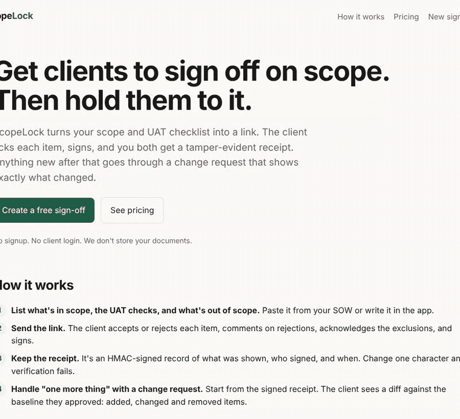
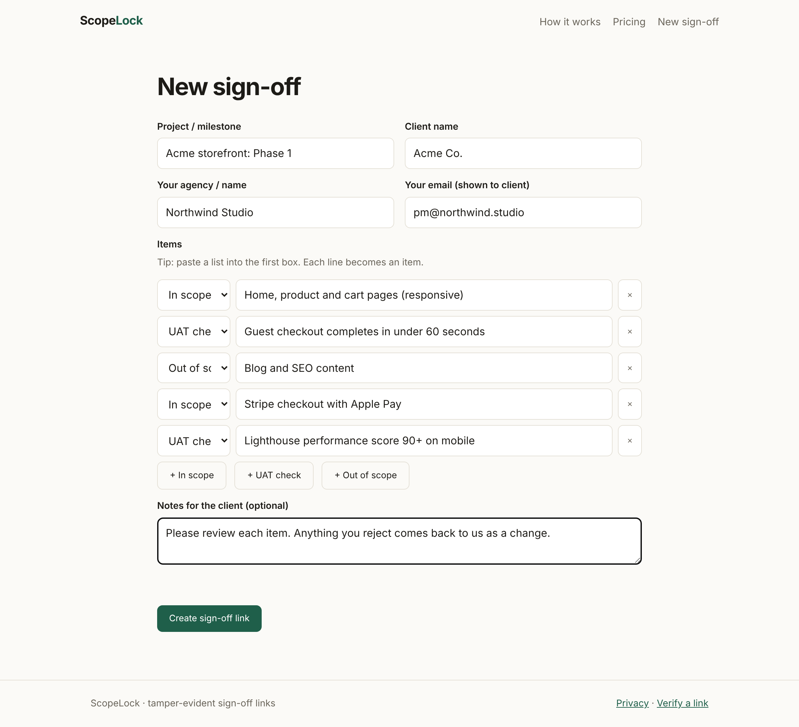
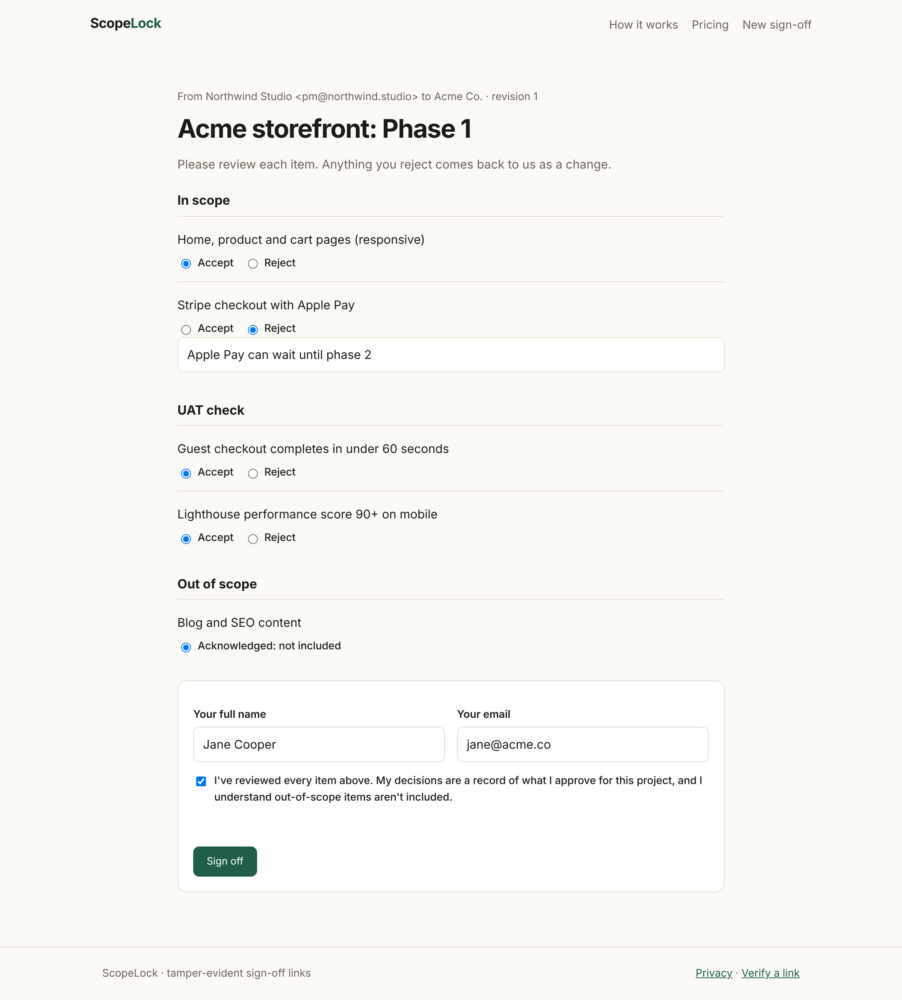
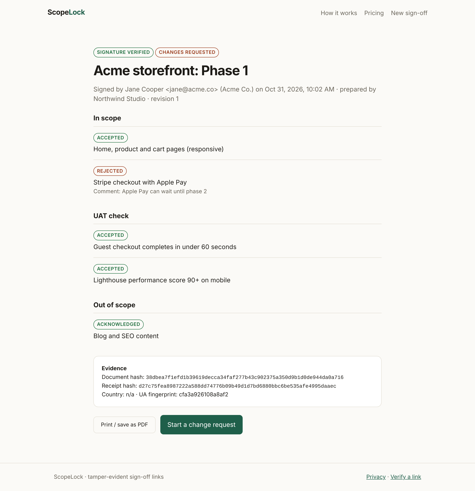
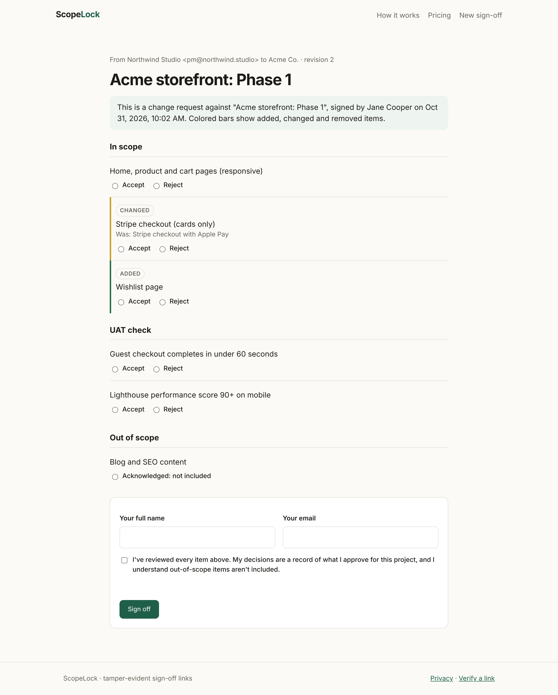
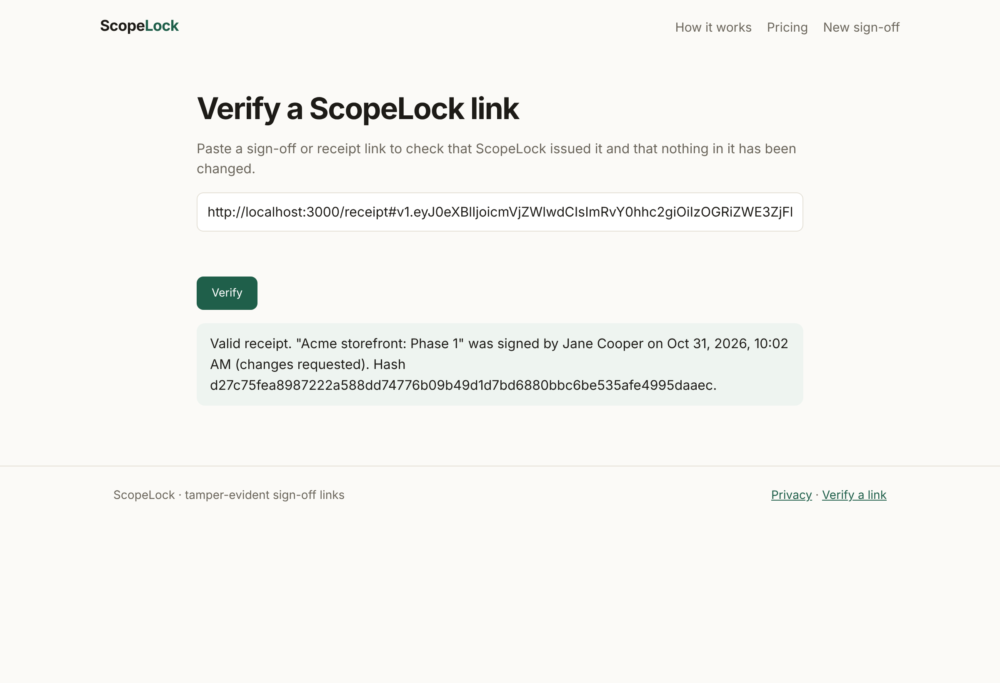
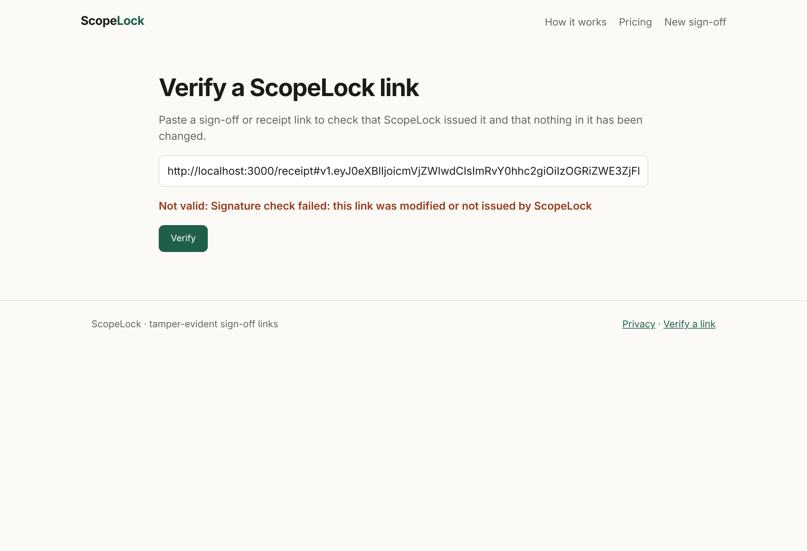
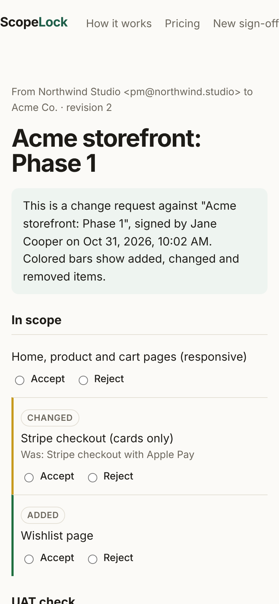

<p align="center"></p>
<h1 align="center">ScopeLock</h1>
<p align="center"><b>Scope and UAT sign-off links with signed receipts.</b><br>
The client accepts or rejects each item and signs, and the client gets an HMAC-signed receipt link to keep and send to the agency. A later request becomes a change request that shows a diff.<br>
No database and no client login.</p>
<p align="center"><a href="https://scopelock-sable.vercel.app">Live app</a> · <a href="#how-it-works">How it works</a> · <a href="#self-host">Self-host</a></p>

<p align="center"><a href="https://scopelock-sable.vercel.app"><b>Try the live demo</b></a> &nbsp;·&nbsp; free, no signup</p>

<p align="center"></p>

## Why

Scope disputes usually come down to one sentence: "I thought that was included." A PDF and an email that says "looks good" do not settle it. ScopeLock records what was shown, what was approved or rejected, who signed and when, in a form neither side can edit without verification failing.

## Screenshots

| 1. Agency creates a sign-off | 2. Client reviews and signs |
|---|---|
|  |  |
| **3. Signed receipt with evidence** | **4. Change request shown as a diff** |
|  |  |
| **5. Anyone can verify a link** | **6. An edited link fails verification** |
|  |  |

<p align="center"><br><sub>The client page on a phone.</sub></p>

## How it works

1. **Seal.** The agency lists in-scope items, UAT checks and out-of-scope exclusions. `POST /api/seal` returns `v1.<base64url(json)>.<hmac>`. That token is the whole document.
2. **Sign.** The client opens `/sign#<token>`. The data sits in the URL fragment, so it is not part of the page request. The page then sends it in the body of an API call that checks the signature and stores nothing. They accept or reject each item (a rejection needs a comment), acknowledge the exclusions and sign. `POST /api/sign` checks the token and returns a signed **receipt** that embeds the document, its SHA-256, the decisions, the signer, a timestamp, the country and a UA hash.
3. **Verify.** `/verify` (or `POST /api/verify`) recomputes the HMAC. If the document changed, verification fails.
4. **Change request.** "Start a change request" on a receipt seals revision *n+1* linked to the baseline receipt's hash. The client sees added, changed and removed items compared with what they approved.

| | Free (this repo) | Pro, planned, $19/mo | Agency, planned, $49/mo |
|---|---|---|---|
| Unlimited sign-off links, receipts, change requests | Yes | Yes | Yes |
| Saved workspace, email notifications, branding, PDF | No | Yes | Yes |
| Seats, white-label domain, API/webhooks | No | No | Yes |

## Security model

* Integrity comes from HMAC-SHA256 with a server secret, compared in constant time. A token cannot be forged or edited without `SIGNING_SECRET`.
* Signer identity is self-declared: the receipt shows what the person who opened the link entered. It is a sign-off record, not an eIDAS or ESIGN qualified signature.
* Rotating the secret makes every existing link fail verification. Key IDs (`v2.<kid>.…`) would fix that, and they are on the roadmap.
* Inputs are size-limited (64 KB body, up to 100 items of 600 characters each, and about 60,000 characters per link). Waitlist sign-ups are rate-limited per IP (5 per 10 min), with counters in Blob under a keyed hash, so raw IPs are never stored. The UI renders everything with `textContent`, under a strict CSP.

## Self-host

```bash
git clone https://github.com/tahmidbintaslim/scopelock && cd scopelock
npm install && npm test
# Vercel: set SIGNING_SECRET (32+ random chars); optional BLOB_READ_WRITE_TOKEN for the waitlist,
# STRIPE_LINK_PRO / STRIPE_LINK_AGENCY for checkout redirects
npx vercel deploy
```

No framework and no build step: static files in `public/` plus five Node functions in `api/`.

### Run it locally

```bash
SIGNING_SECRET=$(openssl rand -base64 32) npm run dev   # http://localhost:3000, no Vercel CLI needed
```

`scripts/capture-screenshots.js` regenerates everything in `docs/img/` from a real run against the dev server.

Payments: Pro and Agency are not built yet, so the landing page links to the waitlist. The `/api/checkout` route and the Stripe test-mode links stay in place for when live mode is approved.

## Roadmap

- [ ] Key IDs and secret rotation
- [ ] Pro: accounts and a workspace (Postgres), email on sign/reject, logo and colors, server-rendered PDF
- [ ] Email OTP to confirm signer identity (optional per document)
- [ ] Import from Markdown, Notion or Google Docs checklists
- [ ] Agency: webhooks, seats, custom domain

## Author

Tahmid Rafi, Lead Full Stack Software Engineer & Solutions Architect, Bangkok.

## License

MIT
