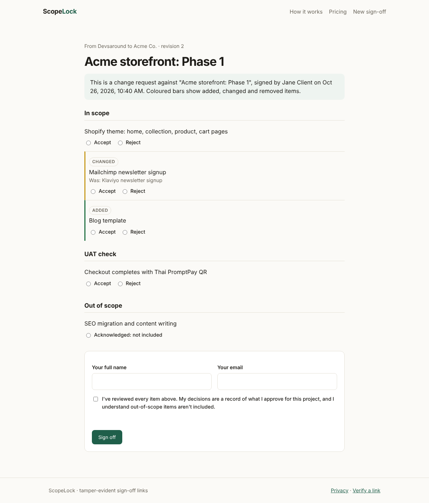

<p align="center"></p>
<h1 align="center">ScopeLock</h1>
<p align="center"><b>Tamper-evident scope and UAT sign-off links for agencies.</b><br>
The client ticks each item and signs, and you both get an HMAC-signed receipt. Every later "one more thing" becomes a change request with a diff.<br>
No database. No client login.</p>
<p align="center"><a href="https://scopelock-sable.vercel.app">Live app</a> · <a href="#how-it-works">How it works</a> · <a href="#self-host">Self-host</a></p>



## Why

Most agency disputes come down to one sentence: *"I thought that was included."* A PDF SOW and an email that says "looks good" don't settle it. ScopeLock records **what was shown, what was approved or rejected, by whom and when**, in a form neither side can quietly edit later.

## How it works

1. **Seal.** The agency lists in-scope items, UAT checks and out-of-scope exclusions. `POST /api/seal` returns `v1.<base64url(json)>.<hmac>`, and that token is the whole document.
2. **Sign.** The client opens `/sign#<token>`. The data sits in the URL fragment, so it never reaches server logs. They accept or reject each item (a rejection needs a comment), acknowledge the exclusions and sign. `POST /api/sign` checks the token and returns a signed **receipt** that embeds the document, its SHA-256, the decisions, the signer, a timestamp, the country and a UA hash.
3. **Verify.** `/verify` (or `POST /api/verify`) recomputes the HMAC. If a single byte changed, verification fails.
4. **Change request.** "Start a change request" on a receipt seals revision *n+1* linked to the baseline receipt's hash. The client sees **added / changed / removed** items relative to what they approved before.

| | Free (this repo) | Pro $19/mo | Agency $49/mo |
|---|---|---|---|
| Unlimited sign-off links, receipts, change requests | ✓ | ✓ | ✓ |
| Saved workspace, email notifications, branding, PDF | | ✓ | ✓ |
| Seats, white-label domain, API/webhooks | | | ✓ |

## Security model (read this before relying on it)

* Integrity comes from HMAC-SHA256 with a server secret, compared in constant time. Tokens can't be forged or edited without `SIGNING_SECRET`.
* Signer identity is **self-declared**: the receipt shows what the person who opened the link claimed. It is a sign-off record, not an eIDAS or ESIGN qualified signature.
* If you rotate the secret, every existing link stops verifying. To rotate safely, add key IDs (`v2.<kid>.…`), which is on the roadmap.
* Inputs are size-limited (64 KB body, 100 items, 600 chars per item). The UI renders everything with `textContent`, under a strict CSP.

## Self-host

```bash
git clone https://github.com/tahmidbintaslim/scopelock && cd scopelock
npm install && npm test
# Vercel: set SIGNING_SECRET (32+ random chars); optional BLOB_READ_WRITE_TOKEN for the waitlist,
# STRIPE_LINK_PRO / STRIPE_LINK_AGENCY for checkout redirects
npx vercel deploy
```

No framework and no build step: static files in `public/` plus four Node functions in `api/`.

## Roadmap

- [ ] Key IDs and secret rotation
- [ ] Pro: accounts and a workspace (Postgres), email on sign/reject, logo and colours, server-rendered PDF
- [ ] Email OTP to confirm signer identity (optional per document)
- [ ] Import from Markdown, Notion or Google Docs checklists
- [ ] Agency: webhooks, seats, custom domain

## License

MIT
